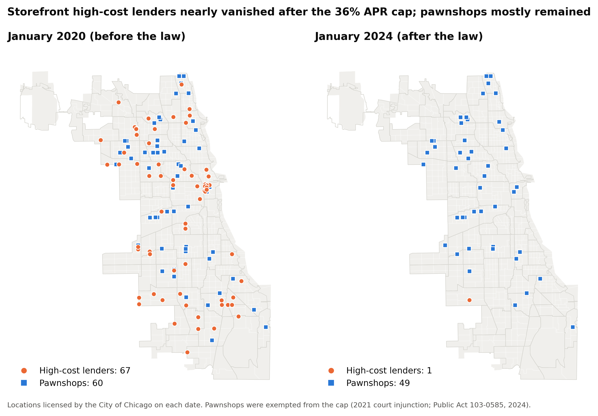

# Did Illinois's 36% Rate Cap Close Chicago's Payday Lenders?

**Research question:** Did Illinois's 2021 Predatory Loan Prevention Act (PLPA), which capped consumer loan APRs at 36%, change the storefront payday and high-cost lending landscape in Chicago, and which neighborhoods were most affected?

1. Before the law, where were high-cost lenders located, and were they concentrated in low-income or majority-Black/Latino neighborhoods?
2. How many closed after the law, and is the timing consistent with the law causing it?
3. Did pawnshops, which were exempted from the cap, fill the gap?

The full write-up is in [`paper/writeup.md`](paper/writeup.md).



## Key findings

- **Near-total exit.** Chicago had 65 licensed high-cost storefront lenders (payday, auto-title and high-APR installment) when the law took effect in March 2021. By January 2023 there was 1, and by 2026 none. Pawnshops (60 → 49, 2020–2024) and storefront businesses overall (−13%) declined slowly.
- **The law is the most likely cause.** Before the law, high-cost lenders and pawnshops closed at similar rates, 5.2% and 3.9% a year. Afterwards, high-cost lenders closed at 77% a year and pawnshops at 5.8%. The difference-in-differences estimate is +70 percentage points (95% CI 60–80). Pre-law trends were parallel. 40 of 65 stores had city licenses cancelled before they expired, mostly within months of the law.
- **Location was driven by commercial activity, not income.** Lenders were not concentrated in low-income tracts. Among equally commercial tracts, a 10-point higher Black share was associated with about 18% higher odds of having a lender (OR 1.18, 95% CI 1.04–1.34). This is robust in some specifications but not the count models, so it is **suggestive**. Latino share showed no association.
- **Pawnshop substitution: inconclusive.** Pawnshops near closed lenders did not measurably outlast those farther away (−1.8 points/year, 95% CI −8.8 to +5.2). Openings were too rare (9 in 12 years) to test.

## Data sources

| Source | Used for |
|---|---|
| [City of Chicago Business Licenses](https://data.cityofchicago.org/Community-Economic-Development/Business-Licenses/r5kz-chrr) (Chicago Data Portal) | Lender and pawnshop locations, 2014–2026 |
| [IDFPR Consumer Credit Licensee List, April 2011](https://web.archive.org/web/20210302072041/https://www.idfpr.com/DFI/CCD/licensees/ConsumerInstallmentLicensees.pdf) (via the Wayback Machine) | Checking that city licenses capture state-licensed lenders |
| [American Community Survey 2015–2019 5-year estimates](https://www.census.gov/data/developers/data-sets/acs-5year.html) (Census API) | Tract income, race/ethnicity, poverty, employment, renters |
| [Chicago census tracts (2010)](https://data.cityofchicago.org/d/74p9-q2aq) and [community areas](https://data.cityofchicago.org/d/igwz-8jzy) | Maps and spatial joins |
| `data/reference/lender_entities.csv` (hand-built) | Which license accounts are high-cost lenders, with evidence for each |

**Why business licenses?** Illinois's regulator (IDFPR) has not published a downloadable list of lender branch addresses since 2011. Every Chicago storefront needs a city license, and the city's records include addresses, coordinates and license dates. A validation check found that 95% of the payday/title branches on the state's 2011 list (80 of 84) held a city license at the same address on the same date. Every high-cost lender in the hand-built list was also cross-checked against that 2011 state list (by name or branch address) or, for one later entrant, the company's own 2021 legislative testimony; see the `check_note` column.

**Considered and dropped:** CFPB complaints (about one per Chicago ZIP code per year, too few) and BLS QCEW industry counts as an out-of-state comparison. QCEW industry codes mix payday lenders with other consumer lenders, and the 2022 industry-code revision breaks the series at the post-law year. Details are in [`data/README.md`](data/README.md) and the write-up.

## Methods (summary)

1. **Storefronts:** license records → lender categories by account number (a hand-checked list) → storefronts defined by standardized address, so ownership changes don't create fake closures → yearly snapshots (Jan 1).
2. **Location models (797 tracts):** logistic regression (any store) and Poisson / negative binomial regression (store counts) on median income, % Black and % Latino, controlling for the number of licensed businesses. Standard errors are clustered by community area. Robustness checks: excluding downtown, and counting stores within 1 mile.
3. **Closure model:** store-year difference-in-differences comparing high-cost lenders with pawnshops (linear probability model, year effects, errors clustered by store), plus a pre-trend test.
4. **Substitution:** pawnshop closure difference-in-differences, near (within 1 mile) vs. far from a lender open at the law date.

## Limitations

- A city license is permission to operate, not proof a store was open. One lower-cost lender (OneMain) stopped holding city licenses in 2019 while its branches stayed open.
- Lenders were identified from a hand-built list. Any whose license names contain none of the search keywords would be missed.
- No out-of-state comparison group, so other 2021 shocks specific to payday lending (for example, COVID-era demand changes) can't be fully ruled out.
- The results are about **storefronts**, not borrowers. Online lending and borrower outcomes are not measured.
- Small numbers: about 67 stores across 797 tracts. ACS tract estimates have sizable margins of error (median about ±19% for income).
- Pawnshops were exempted by a preliminary injunction around September 2021, so they were briefly subject to the cap. A 2024 law (Public Act 103-0585) changed pawnbroker licensing and fees while keeping pawn loans outside the 36% cap.

## Repository layout

```
data/raw/         downloaded source files (never edited by hand)
data/reference/   hand-built lender classification + review list
data/clean/       analysis-ready files produced by src/
src/              all code (run_all.py rebuilds everything)
results/          tables of results + full model output (see results/README.md)
figures/          six publication figures (PNG, 300 dpi)
notebooks/        walkthrough notebook
paper/            the write-up
```

## Reproduce

Requires Python 3.9+ and a free [Census API key](https://api.census.gov/data/key_signup.html).

```bash
python3 -m venv .venv
.venv/bin/pip install -r requirements.txt
printf 'YOUR_KEY' > .census_key           # git-ignored
.venv/bin/python src/run_all.py           # rebuild from the saved raw data
.venv/bin/python src/run_all.py --refresh # or re-download everything first
```

The city license data changes daily, so `--refresh` may shift counts slightly. The raw files in `data/raw/` reproduce the exact numbers reported here (downloaded October 30, 2026).

## Author

Jaskirat Soodan
