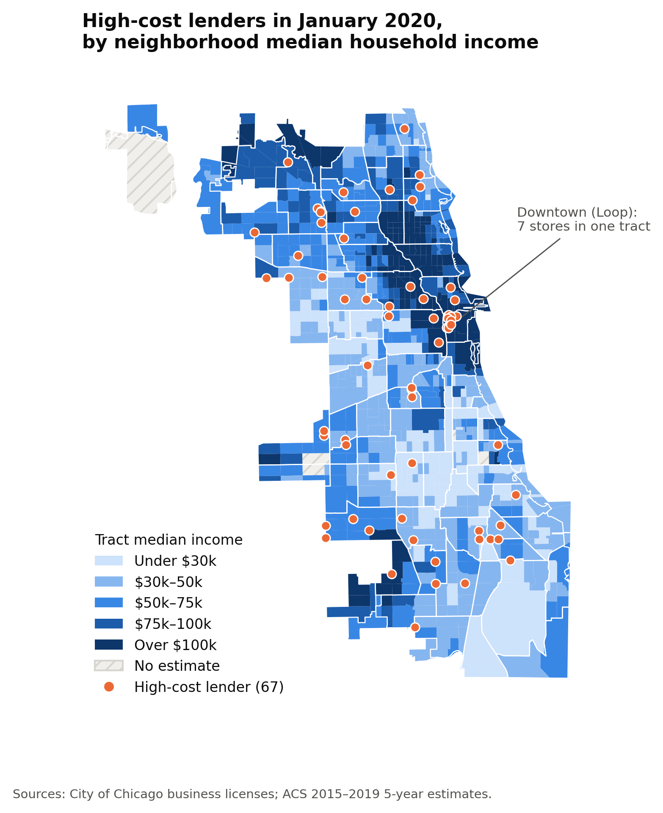
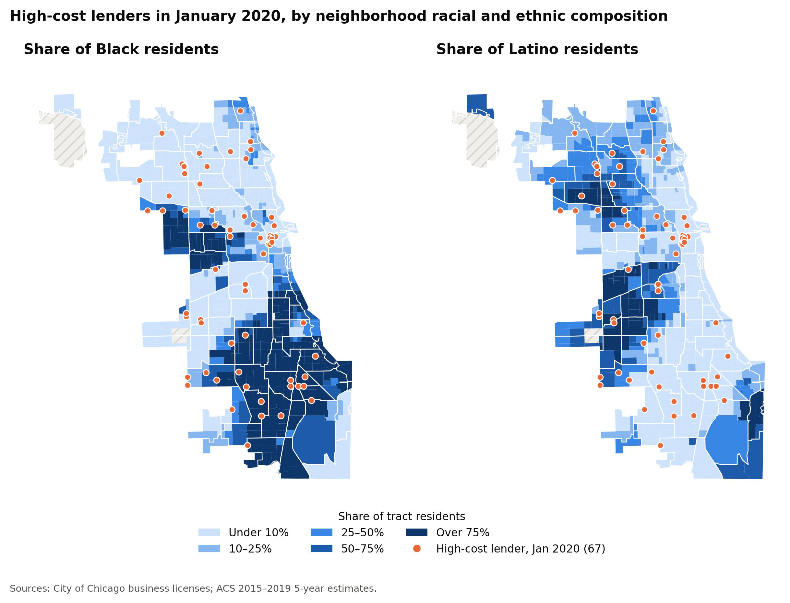
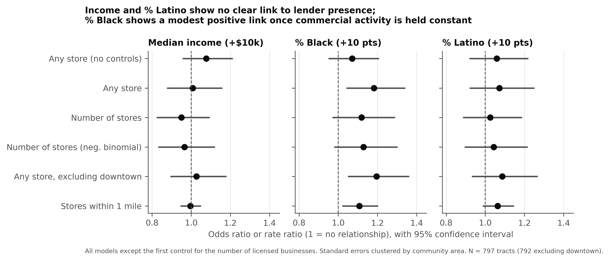
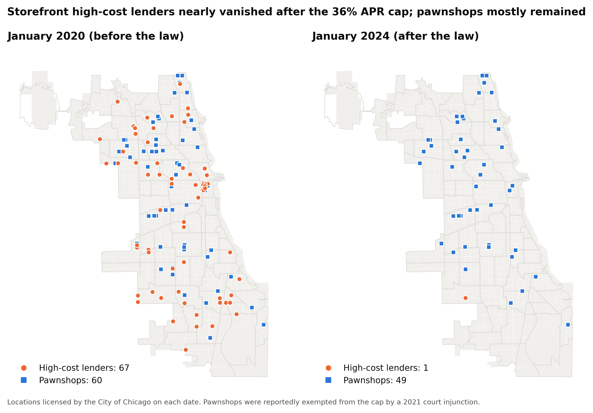
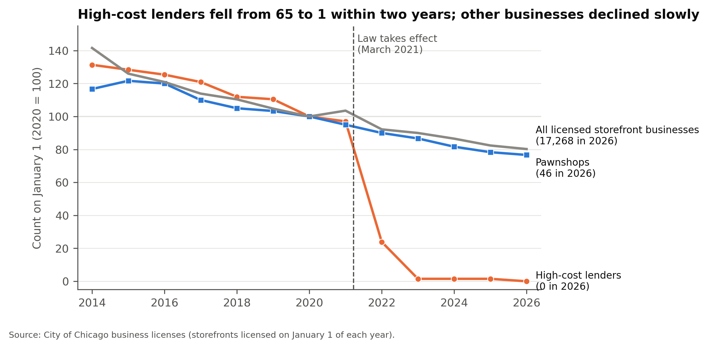
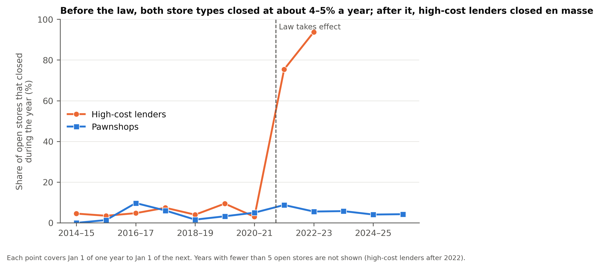

# The Disappearance of Storefront Payday Lending in Chicago After Illinois's 36% Rate Cap

**Jaskirat Soodan**

## Abstract

In March 2021, Illinois's Predatory Loan Prevention Act (PLPA) capped the annual percentage rate on most consumer loans at 36%, well below the triple-digit rates typical of payday and auto-title loans. I build a store-level dataset of Chicago's high-cost lenders from 2014 to 2026 using City of Chicago business licenses, and validate it against the state regulator's archived licensee list. Before the law, lender locations tracked commercial activity rather than neighborhood income. Holding commercial activity constant, there was a modest association with a tract's Black population share. After the law, licensed high-cost storefronts fell from 65 to 1 within two years. Compared with pawnshops, which a court exempted from the cap, the annual closure rate of high-cost lenders rose by about 70 percentage points, with no difference in pre-law trends. I find no measurable evidence that pawnshops replaced the closed lenders, but that test has little statistical power.

## 1. Introduction

Payday loans are small, short-term loans that typically carry APRs of several hundred percent. In Illinois, payday, auto-title and high-cost installment loans were sold from hundreds of licensed storefronts. On March 23, 2021, the PLPA (815 ILCS 123) took effect, applying a 36% all-in APR cap to nearly all consumer lenders other than banks and credit unions. Supporters expected the cap to end high-cost lending; industry groups predicted store closures and reduced access to credit.

This project asks three questions about Chicago. (1) Before the law, where were high-cost lenders located, and were they concentrated in low-income or majority-Black and Latino neighborhoods? (2) Did they close after the law, and is the timing consistent with the law causing the closures? (3) Did pawnshops, which were not subject to the cap, take their place?

Earlier research has examined where payday lenders, pawnshops and check cashers choose to locate (Prager, 2009) and how borrowers respond when payday loan rates are capped (Zinman, 2010). For Illinois, statewide accounts report a collapse in payday licensing after the PLPA (Woodstock Institute). This study adds a store-level, neighborhood-level view for Chicago, a comparison group, and an explicit test of whether the decline began before the law.

## 2. Data

**Lender locations.** The Illinois Department of Financial and Professional Regulation (IDFPR) has not published lender branch addresses since 2011. I instead use the City of Chicago's Business Licenses dataset, which records the owner, address, coordinates and start and end dates of every license. Every Chicago storefront requires one. I downloaded all license records whose names contain lending-related words, plus every Pawnbroker license. I then reviewed the candidate owner accounts by hand. Each account was classified as **high-cost** (payday, title, or high-APR installment lender), **pawn**, **lower-cost**, **uncertain**, or not a storefront lender. The evidence for each decision, mainly the lender's presence on IDFPR's archived 2011 licensee list, is recorded in the repository. Accounts were matched by the city's account number rather than by name. An early name-based search had wrongly counted unrelated businesses (car washes named "Speedy") as lenders.

A **storefront** is a lender category at a standardized street address. Grouping by address merges license renewals and ownership changes: Check 'n Go, for example, moved all ten of its stores to a new corporate account in 2018. Gaps of under a year between licenses at the same address (16 cases) were treated as continuous. A store is counted as open on a date if it held a license covering that date. The main "before" date is January 1, 2020, before both the law and COVID-19. The main "after" date is January 1, 2024: Chicago licenses last two years, so any license still active then was obtained after the law.

**Validation.** The Wayback Machine preserved IDFPR's Consumer Credit Licensee List as of April 5, 2011, with branch addresses. Of the 84 Chicago payday, title and cash-advance branches on that list, 80 (95%) held a city business license at the same address on the same date (90% for all 137 consumer-credit branches). City licenses therefore capture state-licensed storefronts well, at least in 2011.

**Neighborhoods.** Tract characteristics come from the American Community Survey (ACS) 2015–2019 5-year estimates: median household income, racial and ethnic composition, poverty, unemployment and renter share. These describe neighborhoods before the law and use the same 2010 tract boundaries as the maps. Commercial activity is measured as the number of distinct licensed business locations in each tract on July 1, 2019. The analysis uses the 797 of Chicago's 801 tracts that have residents and an income estimate.

**Data considered and dropped.** CFPB consumer complaints about payday and personal loans average about one per Chicago ZIP code per year, too few to detect neighborhood change. BLS establishment counts by industry were considered as an out-of-state comparison. They were dropped because payday lenders share industry codes with other consumer lenders, and the 2022 revision of those codes breaks the series in the first post-law year.

## 3. Methods

**Location (Question 1).** I compare tracts with and without a high-cost store in 2020, and compare each neighborhood group's share of Chicago's residents with its share of stores. I then estimate logistic regressions for whether a tract had any store, and Poisson and negative binomial regressions for the number of stores. Predictors are median income (per $10,000), percent Black and percent Latino (per 10 points), and the log of licensed businesses. The business control matters because lenders, like most retailers, open on commercial streets. Without it, a model may simply rediscover where shopping districts are. Standard errors are clustered by Chicago's 77 community areas, because neighboring tracts are not independent. Robustness checks exclude downtown (the Loop) and replace the tract count with the number of stores within one mile of the tract's center, since a store serves more than its own tract.

**Closures (Question 2).** Using a store-year panel, I model whether a store open on January 1 closed by the following January 1. Pawnshops serve as the comparison group. They are fringe-finance storefronts in similar neighborhoods and faced the same economic shocks, including COVID-19. Pawnbrokers obtained a preliminary injunction in Sangamon County Circuit Court around September 2021 that blocked enforcement of the cap against them (Rock River Current, 2022). The difference-in-differences estimate is the change in high-cost lenders' closure rate after 2021, minus the change for pawnshops. It is estimated as a linear probability model, with and without year effects, and errors clustered by store. The method assumes the two groups would have followed parallel trends without the law, so I test whether their closure rates were already diverging before 2021.

**Substitution (Question 3).** If former payday borrowers turned to pawnshops, pawnshops near closed lenders should have fared better after the law. I estimate a difference-in-differences on pawnshop closures, comparing pawnshops within one mile of a lender open on the law date with pawnshops farther away. I also count new pawnshop openings.

## 4. Results

### 4.1 Where lenders were located

On January 1, 2020, Chicago had 67 licensed high-cost storefronts in 54 tracts (Figures 1 and 2). They were not concentrated in low-income areas. The poorest fifth of tracts held 15% of residents and 12% of stores, while the richest fifth held 21% of residents and 28% of stores. Much of the latter reflects seven stores in a single downtown tract. Majority-Black tracts held 27% of residents and 31% of stores. Majority-Latino tracts held 24% of residents but only 15% of stores. The clearest difference was commercial: tracts with a store averaged 153 licensed businesses, against 54 elsewhere.

*Figure 1. High-cost lenders in January 2020 over tract median household income.*

*Figure 2. High-cost lenders in January 2020 over the share of Black and Latino residents.*

The regressions support this picture (Figure 6). Commercial activity is the dominant predictor. A one-unit increase in log businesses, about 2.7 times as many businesses, roughly triples the odds of having a store (odds ratio 3.37, 95% CI 2.37–4.79). Median income is unrelated to lender presence in every specification (e.g. OR 1.01 per $10,000, CI 0.88–1.16). Holding commercial activity constant, each additional 10 points of Black population share is associated with about 18% higher odds of having a store (OR 1.18, CI 1.04–1.34). The association holds when downtown is excluded (OR 1.20, CI 1.05–1.36) and when access is measured as stores within one mile (rate ratio 1.11, CI 1.02–1.20). It is weaker, and not statistically significant, in the two store-count models (RR 1.12, CI 0.97–1.29; negative binomial RR 1.13, CI 0.98–1.30). Without the commercial control, the association disappears (OR 1.07, CI 0.95–1.21), because majority-Black neighborhoods have fewer businesses overall. Percent Latino shows no association in any specification. Predictor correlation is acceptable (variance inflation factors at most 3.4).

These results describe where **stores** were, not where **borrowers** lived. An analysis of borrower ZIP codes found payday borrowing concentrated in Black and Latino communities (New America). The two findings are compatible, because borrowers travel to stores and many loans were made online.

*Figure 6. Estimated associations with lender presence across model specifications (95% confidence intervals).*

### 4.2 Closures after the law

High-cost storefronts had declined slowly before the law, from 88 in 2014 to 65 in 2021, roughly in line with storefront businesses citywide. After the law they collapsed: 16 remained in January 2022 and 1 in January 2023 (Figures 3 and 4). Pawnshops fell from 60 to 49 between 2020 and 2024, and all licensed storefront businesses fell 13%.

*Figure 3. High-cost lenders and pawnshops licensed in January 2020 and January 2024.*

*Figure 4. Store counts indexed to 2020 = 100.*

Of the 65 stores licensed on the day the law took effect, 40 had their licenses cancelled before expiration, mostly within months. Check Into Cash, LendNation and Speedy Cash cancelled all their Chicago licenses within three months. Every chain's last license had ended within 17 months, except one store that held a license until 2025.

Before the law, high-cost lenders closed at 5.2% per year and pawnshops at 3.9% (Figure 5). Afterwards, the rates were 77% and 5.8%. The difference-in-differences estimate is **+70 percentage points** (95% CI 60–80). With separate effects for each year, which absorb shocks such as COVID-19, it is +69 points (CI 57–81). Before 2021, the gap between the two groups' closure rates was not changing (−0.1 points per year, CI −1.3 to +1.0, p = 0.83), which supports the parallel-trends assumption.

*Figure 5. Share of open stores that closed during each year.*

### 4.3 Did pawnshops fill the gap?

I find no measurable substitution, but the test is weak. Only nine pawnshops opened in Chicago between 2014 and 2026: five before the law and four after. After the law, pawnshops within a mile of a lender were no more likely to stay open than those farther away. The difference-in-differences estimate is −1.8 points per year, with a confidence interval from −8.8 to +5.2 (p = 0.61), wide enough to include meaningful effects in either direction.

## 5. Limitations

1. **A license is not a store.** A license shows permission to operate, not activity. One lower-cost lender, OneMain, stopped holding city licenses in 2019 although its branches remained open, so a lapsed license does not always mean a closure. For high-cost lenders, early cancellations, closures concentrated in the months after the law, and the statewide fall in payday licenses all point to real closures.
2. **Classification.** High-cost lenders were identified from a hand-built list. Lenders whose license names contained none of the search terms would be missed. Seven small-loan companies of unknown pricing were classified as "uncertain" and excluded.
3. **No out-of-state comparison.** Pawnshops share Chicago's economic conditions but are a different business. A shock affecting only payday lenders in 2021, such as reduced demand during the pandemic, cannot be fully ruled out. Store-level data from a state without a cap would strengthen the causal claim.
4. **Storefronts only.** The study does not observe online lending, loan volumes or borrower well-being. Store closures are not the same as borrowers being better or worse off.
5. **Small numbers and measurement error.** About 67 stores across 797 tracts limit statistical power. ACS tract estimates carry sizable margins of error (median ±19% for income). Several location results are sensitive to model choice, and some significance could arise by chance across the many tests run.
6. **The comparison group was briefly treated.** Pawnshops were subject to the cap from March until the injunction around September 2021. Later legislative changes for pawnbrokers have not been verified.

## 6. Conclusion

Chicago's storefront high-cost lending industry was almost entirely gone within two years of Illinois's 36% rate cap. The timing, the size of the change relative to pawnshops, and the absence of any earlier divergence make the law the most plausible cause. Before the law, lenders were located mainly along commercial corridors and were not concentrated in low-income neighborhoods. There was a modest, model-dependent tilt toward neighborhoods with more Black residents. Whether former borrowers moved to pawnshops, online lenders, or other options remains open. Answering it will require borrower-level or transaction-level data.

## References

- City of Chicago. *Business Licenses* (dataset r5kz-chrr). Chicago Data Portal. Accessed October 30, 2026.
- Illinois Department of Financial and Professional Regulation. *Consumer Credit Licensee List (to 4/5/2011).* Archived by the Internet Archive Wayback Machine.
- Illinois General Assembly. *Predatory Loan Prevention Act*, 815 ILCS 123.
- New America. *Ill-Gotten Gains: Predatory Lending and the Racial Wealth Gap in Chicago.*
- Rock River Current (2022, December 14). "Pawn shops in Rockford, across Illinois raise issue with proposed interest rate caps."
- U.S. Census Bureau. *American Community Survey 2015–2019 5-Year Estimates*, via the Census Data API.
- Woodstock Institute. *The Predatory Loan Prevention Act Is Working.*
- Prager, R. A. (2009). *Determinants of the Locations of Payday Lenders, Pawnshops and Check-Cashing Outlets.* Federal Reserve Board, Finance and Economics Discussion Series 2009-33.
- Zinman, J. (2010). Restricting consumer credit access: Household survey evidence on effects around the Oregon rate cap. *Journal of Banking & Finance*, 34(3), 546–556.

*Code, data and full model output: see the repository README. All results can be reproduced with `python src/run_all.py`.*
